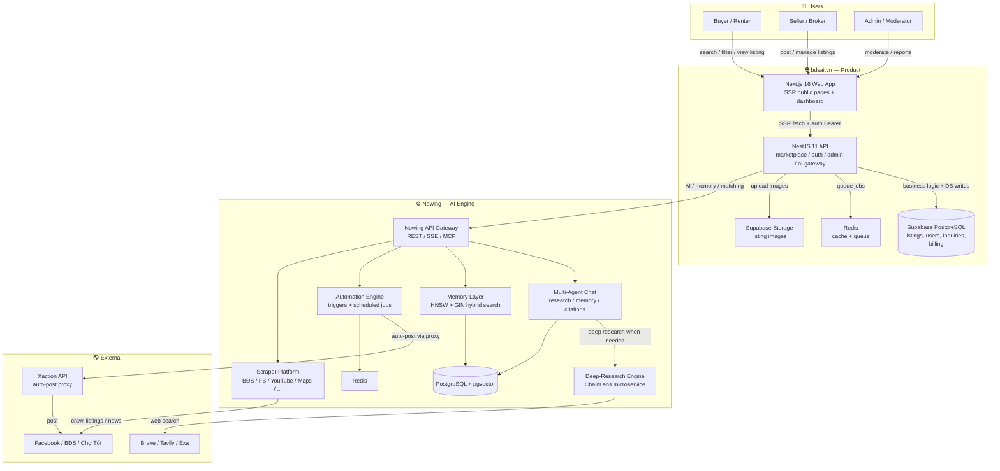

# System Context — bdsai.vn ↔ Nowing Engine

> Bức tranh tổng thể: **bdsai.vn là sản phẩm/sàn rao vặt BĐS**; **Nowing là engine AI headless** chạy sau lưng, cung cấp năng lực multi-agent chat, memory, matching, automation, scraper, deep-research. Hai codebase tách rời, giao tiếp qua API.

---

## 1. Kiến trúc tổng thể (Phase 1 — post-pilot)



---

## 2. Kiến trúc Phase 0 — Pilot Zalo (2 tuần)

```mermaid
flowchart LR
    B[Broker / Môi giới<br/>Zalo group]
    Z[Zalo burner<br/>zca-js]
    S[Thin Node.js script<br/>parse + call Nowing]
    T[Tracker CSV / Notion]
    L[Luis concierge]

    B -->|gửi filter: "tìm đất Bình Thạnh 3-4 tỷ"| Z
    Z --> S
    S -->|filter JSON| API[Nowing API]
    API -->|match / Deal-Radar| S
    S -->|alert tin nhắn| Z
    Z --> B
    S --> T
    L --> T
    L -->|handoff khi match đạt ngưỡng| B
```

---

## 3. Ranh giới sở hữu (Ownership Boundary)

| Layer | bdsai.vn owns | Nowing owns |
|-------|---------------|-------------|
| **UX / Surface** | listings, search, filter, SEO, broker CRM, admin UI | chat UI, memory browser, connector admin, automation builder |
| **Business Logic** | listing lifecycle, moderation, billing, lead routing, BĐS-specific matching rules | multi-agent orchestration, memory recall, RAG, scraper scheduling, research pipeline |
| **Data** | `listings`, `users`, `inquiries`, `cross_posts`, `billing` | `memories`, `documents`, `chunks`, `runs`, `automations`, `threads` |
| **AI Models / Providers** | none directly — calls Nowing API | LLM routing, embedding model policy, cost metering |
| **Crawlers / Deep Web** | none — requests via Nowing API | platform scrapers (BSL 1.1), ChainLens deep-research engine |
| **Auth** | Supabase Auth + NestJS admin guard | internal JWT / API keys for engine access |
| **Infra** | Vercel + Dokploy + Supabase | self-hosted or Nowing Cloud (managed) |

---

## 4. Luồng dữ liệu điển hình

### 4.1. Buyer tìm kiếm + AI chat trên listing

1. Buyer mở `/listings/[id]` — **bdsai FE** SSR từ **bdsai BE**.
2. FE gọi **Nowing API** để lấy AI summary / similar listings từ **Memory**.
3. Buyer hỏi trong chat widget — bdsai FE proxy tin nhắn qua bdsai BE → **Nowing Multi-Agent Chat**.
4. Nowing agent truy vấn **Memory + Hybrid Search**, gọi **ChainLens** nếu cần deep research.
5. Trả về câu trả lời có citations → bdsai FE render.

### 4.2. Broker đăng tin + Deal-Radar

1. Broker đăng tin trên **bdsai FE** → **bdsai BE** lưu `listing`.
2. bdsai BE gọi **Nowing Automation API** kích hoạt automation "Deal-Radar".
3. Nowing **Memory + Scraper** tìm tin/nhu cầu khớp (có thể gọi **Scraper Platform**).
4. Khi match đạt ngưỡng, Nowing trả alert → bdsai BE gửi Zalo/email cho broker.

### 4.3. Admin kiểm duyệt + Trust Score

1. Admin duyệt listing trên **bdsai Admin UI**.
2. bdsai BE gọi **Nowing AI Module** để lấy Trust Score + AI Summary.
3. Nowing trả kết quả dựa trên listing content + historical memory.
4. bdsai BE lưu score + hiển thị kèm disclaimer.

---

## 5. Contract & API Boundary

- **bdsai BE → Nowing API:** authenticated REST/SSE calls.
- **Không gọi trực tiếp ChainLens / scraper engine** từ bdsai — phải qua Nowing API.
- **Workspace isolation:** bdsai sử dụng một hoặc nhiều Nowing workspace; mỗi workspace có `workspace_id` riêng.
- **Cost metering:** Nowing trả về `cost_micros` / `cost_dollars` per call; bdsai BE ghi log để tính giá thành / billing.

---

## 6. License & Deployment Boundary

| Component | License | Self-host | Cloud |
|-----------|---------|-----------|-------|
| bdsai.vn product | (tùy dự án) | ✅ | ✅ |
| Nowing core | Apache-2.0 | ✅ | ✅ |
| Nowing crawler engine | BSL 1.1 | ✅ (không bán lại hosted) | ✅ via Nowing Cloud |
| ChainLens deep-research | Closed-source | Phase 1 ❌, Phase 2 💳 | ✅ |

---

## 7. Key Invariants

- **AD-11 — Nowing Engine Boundary:** bdsai chỉ gọi Nowing qua API. Nowing owns AI/memory/matching/automation/scraper/deep-research.
- **AD-12 — Pilot Data Isolation:** pilot data không rò rỉ vào production schema.
- **AD-2 — Single Mutation Path:** mọi write nghiệp vụ BĐS qua bdsai BE → DB, không ghi trực tiếp từ FE.
- **AD-3 — Xaction as External Service:** auto-post qua Xaction luôn async, có provider pattern + fallback.
